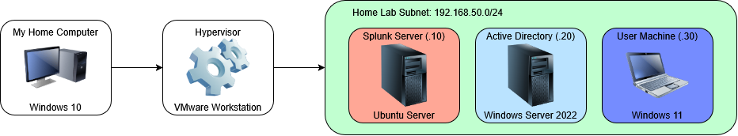

## Introduction

This is a demonstration of my ability to create and document a small windows enterprise environment using SOC tools. The documentation section is for detailing the process of setting up and configuring VMware workstation (hypervisor) and the virtual machines. The Detection section is for covering SPL queries, testing methodologies, false/true positives, etc.

## Architecture

Currently, there are 3 virtual machines in use. The first machine is an Ubuntu server which is used for running Splunk (SIEM). The second is a machine running Windows server 2022, acting as the active directory. And the third machine is a host machine acting as an end user to perform various tests. 

Below you can find the general architecture of what everything looks like at a high level.

## Virtual Machine Technologies

**Ubuntu Server**: Splunk

**Windows Server 2022**: Server Manager, Powershell, Windows Event Manager, Sysmon, Splunk Forwarder

**User Machine**: Powershell, Windows Event Manager, Sysmon, Splunk Forwarder