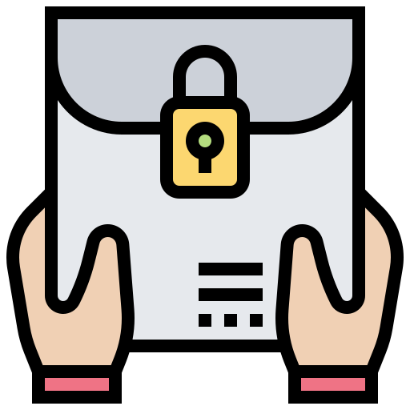
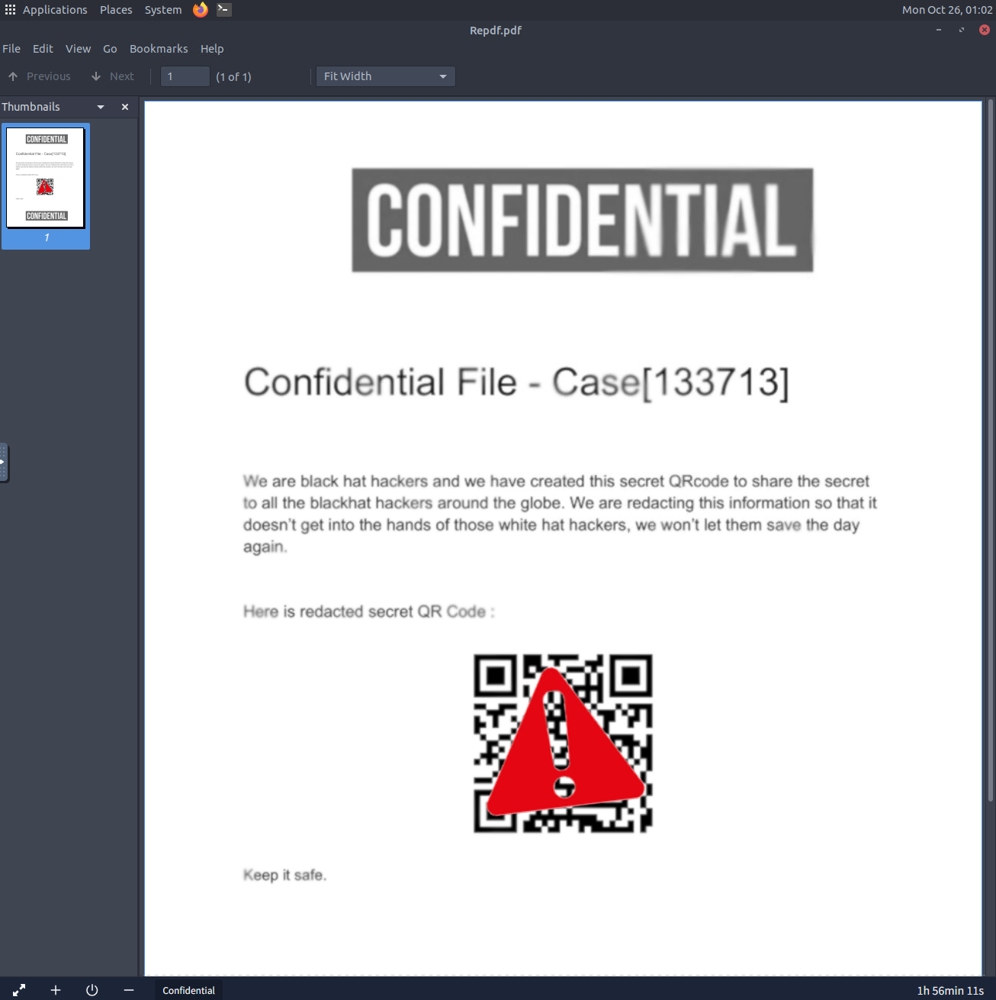
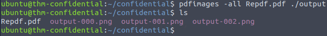
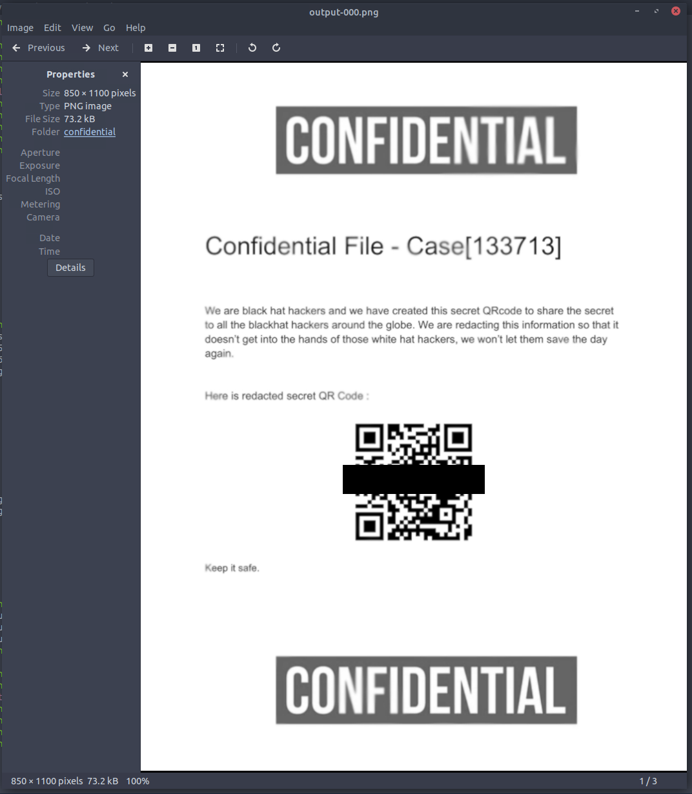

# Confidential Room

This is a writeup for the Confidential room on TryHackMe.

You can find this room here: https://tryhackme.com/room/confidential

## Hidden QR Code

A confidential case file was received by black hat attackers. This file is a PDF file which contains a QR code, but it's been covered with an image.

When I first opened the file I tried to cheat and used my mouse to drag the QR code out from the image covering it. It turns out the whole PDF is covered by an invisible image so this approach didn't work.

The next best option is to use a tool called **pdfimages** which as the name suggests, extracts images from pdf files.

In the same directory as the pdf file I ran the following command.

> pdfimages -all Repdf.pdf ./output

And I received this output.

Opening the output reveals this image (I partially covered the QR code in this).

After scanning the QR code with my phone I receive the flag for the room.

## Conclusion

Overall a decent short room, you get to use a tool which isn't used often at all which is always fun.

(though I'm not exactly sure why the pdf file the attackers sent was blurry)