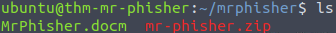
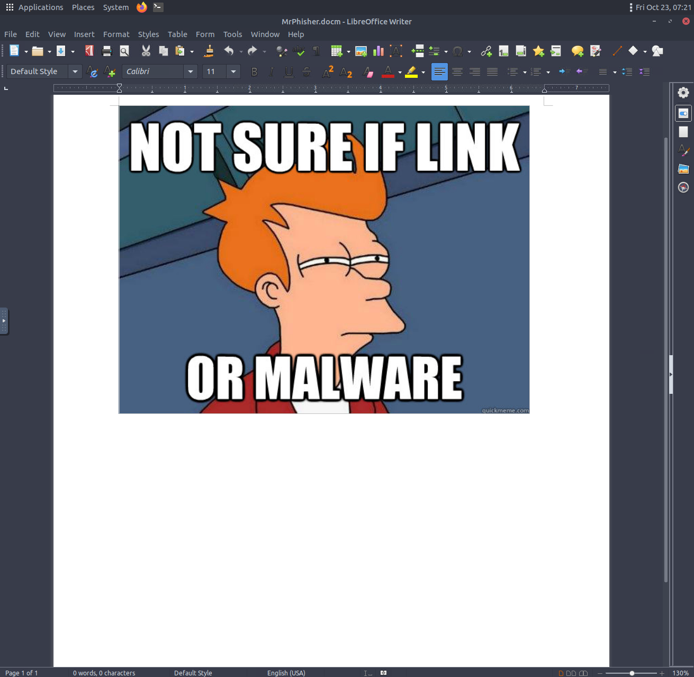
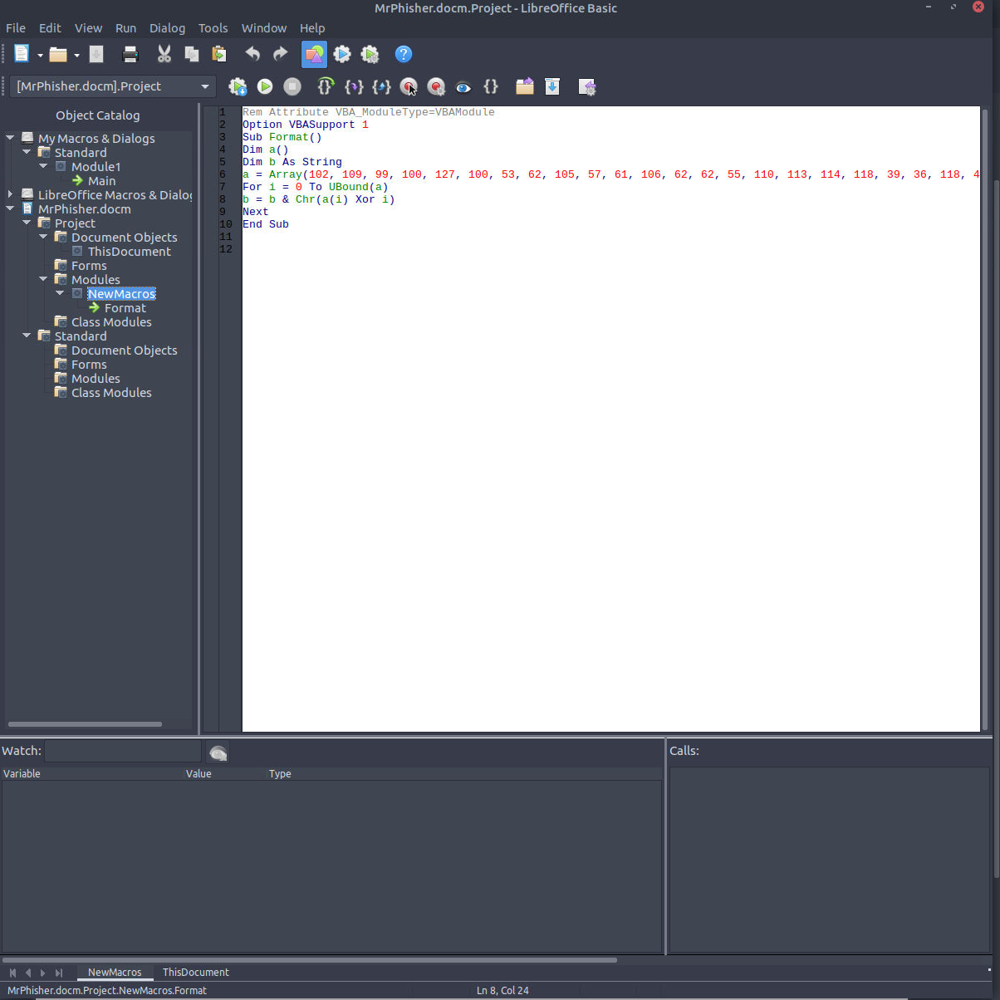
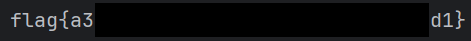

# Mr. Phisher Room


This is a writeup for the Mr. Phisher room on TryHackMe.

You can find this room here: https://tryhackme.com/room/mrphisher

## Suspicious Attachment

A suspicious email was received with MrPhisher.docm attached.



Opening the file reveals an Image.



Investigating the Macros Tab reveals a VBA script.



This VBA macro is taking a list of numbers, performs an XOR operation on each number for its index, and then appends it to B

Unfortunately LibraOffice Writer refused to run the VBA script, so I decided to copy the VBA function and recreate it in python.

```
a = [102, 109, 99, 100, 127, 100, 53, 62, 105, 57, 61, 106, 62, 62, 55, 110, 113, 114, 118, 39, 36, 118, 47, 35, 32, 125, 34, 46, 46, 124, 43, 124, 25, 71, 26, 71, 21, 88] 
b = "" 
for i in range(len(a)): 
    b += chr(int(a[i] ^ i)) 
print(b)
```

After running this script I get the flag!


